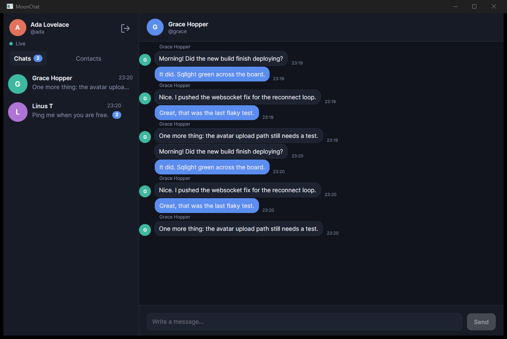
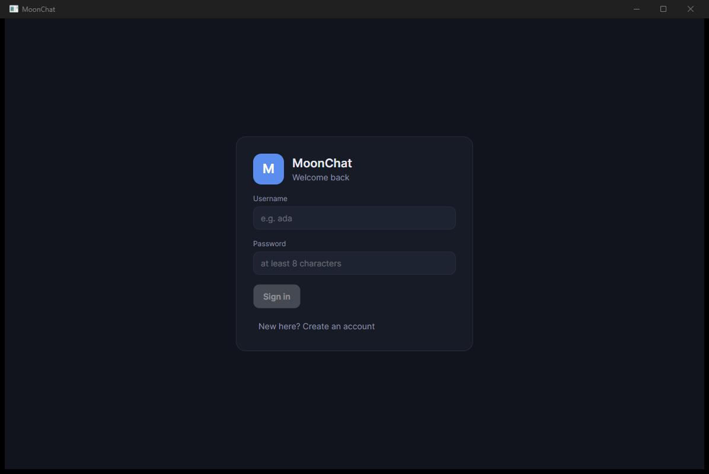

<div align="center">

# MoonChat — desktop client

The native desktop client for **MoonChat**, a small messenger with accounts,
contacts, avatars and one-to-one messaging over a websocket.

Built with **Avalonia UI** on .NET 10: XAML rendered by Skia, no web view and no
browser engine anywhere in the app.

<p>
  
  
</p>

</div>

---

> **This repository holds the client only.** The backend is a separate Go
> service and is not part of this repository; see [Running it](#running-it).

## Features

- **Accounts** — registration and sign-in, with the session remembered between launches
- **Contacts** — add someone by username, see who is online, start a thread from the list
- **Avatars** — round avatars with a stable coloured initial when no image is set
- **Messaging** — direct conversations, history, and infinite scroll back through it
- **Live updates** — new messages, typing indicators, presence and read receipts arrive over a websocket
- **Unread counts** — per conversation and summed in the sidebar
- **Resilient** — reconnects with exponential backoff and resyncs anything missed while offline
- **Calm interface** — dark theme, grouped messages, Enter to send and Shift+Enter for a newline

## Tech stack

| | |
|---|---|
| UI | Avalonia 12 (XAML + Skia) |
| Language | C# / .NET 10 |
| Architecture | MVVM, `INotifyPropertyChanged`, small `RelayCommand` helper |
| Transport | `System.Net.WebSockets`, `HttpClient` |
| Rendering notes | Avatars are fetched through the authenticated `HttpClient` and cached as in-memory bitmaps, because an image request cannot carry a bearer token |

## Running it

The client needs a MoonChat server to talk to.

```powershell
dotnet run
```

It connects to `http://127.0.0.1:8080` by default. Point it elsewhere without
rebuilding:

```powershell
$env:MOONCHAT_API_BASE = 'https://chat.example.com/'
dotnet run
```

### Configuration

| Variable | Default | Notes |
|---|---|---|
| `MOONCHAT_API_BASE` | `http://127.0.0.1:8080/` | Base address of the MoonChat API |
| `MOONCHAT_DEBUG_LOG` | *(unset)* | Writes app logs and Avalonia diagnostics to this file. Set it when something looks wrong — binding failures are otherwise silent |

## What the client expects from the server

A bearer token in `Authorization: Bearer <token>` on every request except
`/api/auth/register` and `/api/auth/login`.

| Method | Path | Purpose |
|---|---|---|
| `POST` | `/api/auth/register` | `{ username, displayName, password }` → `{ token, user }` |
| `POST` | `/api/auth/login` | `{ username, password }` → `{ token, user }` |
| `GET` | `/api/auth/me` | current profile |
| `GET` | `/api/contacts` | contacts with live presence |
| `POST` | `/api/contacts` | add by username; the link is mutual |
| `DELETE` | `/api/contacts/{userId}` | one-directional removal |
| `PUT` | `/api/users/me/avatar` | raw image body or multipart `file` |
| `GET` | `/api/avatars/{file}` | avatar bytes |
| `GET` | `/api/conversations` | threads with unread counts and last message |
| `POST` | `/api/conversations` | find-or-create the thread with a contact |
| `GET` | `/api/conversations/{id}/messages?before=`\|`after=` | one page of history |
| `POST` | `/api/conversations/{id}/messages` | send (used as fallback when the socket is down) |
| `POST` | `/api/conversations/{id}/read` | `{ messageId }` |
| `WS` | `/api/ws` | live channel |

Websocket frames use one envelope, `{ "type", "id"?, "payload"? }`:

| Direction | Type | Payload |
|---|---|---|
| → | `send_message` | `{ conversationId, body, clientMessageId }` |
| → | `typing` | `{ conversationId, typing }` |
| → | `read_receipt` | `{ conversationId, messageId }` |
| → | `refresh_token` | `{ token }` |
| ← | `hello` | `{ userId, username, serverTime }` |
| ← | `message_new` | `{ message }` |
| ← | `ack` | `{ clientMessageId, message }` |
| ← | `presence` | `{ userId, online, lastSeenAt }` |
| ← | `typing` | `{ conversationId, userId, typing }` |
| ← | `error` | `{ code, message }` |

### How the client behaves

- **No optimistic rendering.** A message is shown only after the server stored
  it. Until the ack arrives the sender sees a dimmed "sending…" bubble, so what
  you see and what is saved never disagree.
- **Websocket first.** Messages go over the socket when it is connected and fall
  back to `POST /api/conversations/{id}/messages` when it is not.
- **History is cursor-based.** `messages.id` is monotonic, so `?after=<id>`
  fetches exactly what was missed.
- **The thread follows new messages** only when the newest one is what changed,
  so scrolling back through history is not yanked to the bottom.

## Project layout

```
client/
├── Views/          MainWindow, LoginView, ChatView
├── Controls/       AvatarView
├── ViewModels/     shell, login, chat, message rows, RelayCommand
├── Services/       ApiClient, ChatState (realtime), SessionStore, AvatarCache
├── Converters/     value converters
├── Models/         DTOs mirroring the server contract
└── App.axaml       palette and control styles
```

`Services/` holds all the protocol knowledge and knows nothing about the UI;
`ViewModels/` mirror it into bindable state; the XAML only renders.

## Requirements

- .NET 10 SDK

Visual Studio works without extra components for build and debug. The **XAML
designer** needs the [Avalonia VS](https://marketplace.visualstudio.com/items?itemName=AvaloniaTeam.AvaloniaVS)
extension, otherwise `.axaml` files open as plain text.

## Building

```powershell
dotnet build -c Release
dotnet publish -c Release -o out
```

## Status

Working: sign-in and registration, contacts, avatars, direct conversations,
history, live delivery, typing indicators, presence, unread counts, read
receipts, offline resync.

Not built: group chats, attachments, message editing or deletion, desktop
notifications, avatar picker in the UI, and end-to-end encryption.

## License

No license has been chosen yet. Add one before publishing this anywhere.